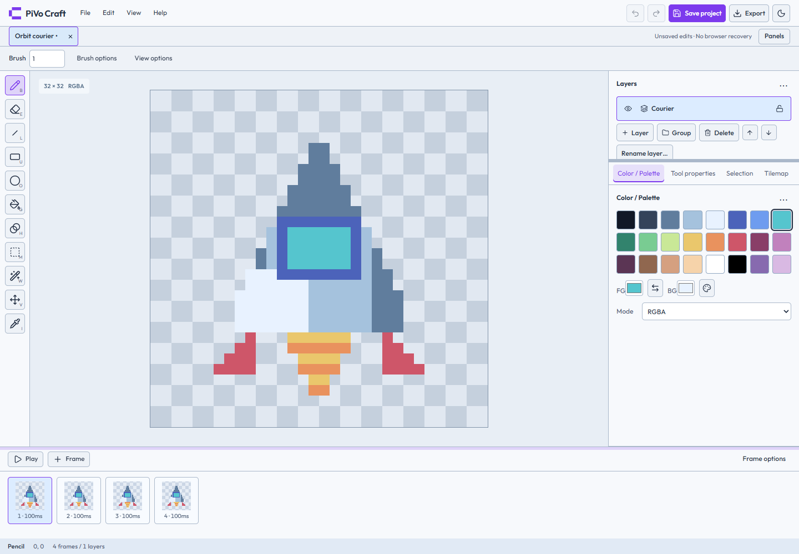

# PiVo Craft

A local-first browser pixel-art and animation editor.

[Open app](https://bookklik-technologies.github.io/pivo-craft/) · [Documentation](https://bookklik-technologies.github.io/pivo-craft/docs/)



## Run locally

Use Node.js 24 and npm.

```sh
npm ci
npm run dev
```

Open the local URL printed by Vite. Use a current desktop browser. Projects stay in your browser; save downloaded project files as backups.

## Build and documentation

```sh
npm run build         # production app in dist/
npm run docs:dev      # local documentation server
npm run docs:build    # static docs in docs/.vitepress/dist/
npm run docs:preview  # preview docs after building
```

See the [tutorials](https://bookklik-technologies.github.io/pivo-craft/docs/tutorials/), [limitations](docs/limitations.md), and [verification](docs/verification.md) for usage, supported features, and recorded checks.

## License

Released under the [MIT License](LICENSE). Dependency license texts are included in [docs/third-party](docs/third-party/).
